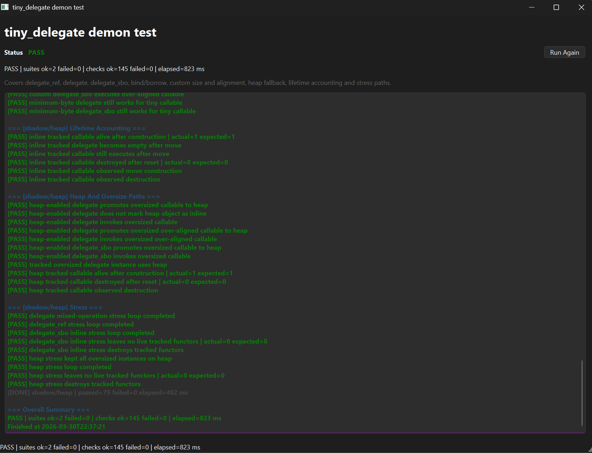

# tiny_delegate

[](https://github.com/shpegun60/delegate/actions/workflows/ci.yml)
[](LICENSE)

`tiny_delegate.hpp` is a compact C++17/C++20 callback library with three related delegate types:

Current version: **1.2.0**. See [CHANGELOG.md](CHANGELOG.md) for release changes.

- `tiny::delegate_ref<Sig>`: non-owning, cheap to copy and rebind
- `tiny::delegate_sbo<Sig, InlineBytes, InlineAlign>`: owning, move-only, SBO-first
- `tiny::delegate<Sig, InlineBytes, InlineAlign>`: hybrid, move-only, owns by default but can switch into explicit ref mode

It is aimed at projects that want a small, explicit, predictable callback abstraction without immediately defaulting to `std::function`.

The signature feature in one screenshot — a dispatch table that lives
entirely in flash (verified in `.rodata`: 8 bytes per entry on ARM32,
zero RAM, zero startup code):

```cpp
static constexpr tiny::delegate_ref<int(int)> rom_table[] = {
    freeDouble,
    &freeNegate,
    [](int value) noexcept { return value - 1; },
    +[](int value) noexcept { return value + 1; },
    tiny::delegate_ref<int(int)>::bind<&StaticSvc::shift, g_svc>(),
};
```

Since 1.1.0, ordinary function pointers and inline `[]` or `+[]` captureless lambdas
can initialize a `constexpr delegate_ref` directly in C++17 and C++20.
Only the binding is constant-initialized: `operator()` executes at runtime,
and the target function can read changing application data. The target does
not need to be a `constexpr` function.

Bare lambdas use a constrained constructor that converts them to the signature's
function-pointer type; the closure is not retained. Captureless generic lambdas
are accepted when that conversion is available. A lambda that captures data
still needs `tiny::borrow(lvalue)` or an owning delegate. Bare-lambda assignment
is supported as well.

`bind<&function>()` is also supported and bakes the target into its invoker;
the ordinary constructor stores a typed function pointer. These forms have
the same object size but can produce different target-call sequences.

Use `delegate_ref` for ROM tables. `delegate` and `delegate_sbo` manage owned
objects through placement construction and non-trivial destruction; their
instances are not constexpr table elements in either supported language mode.
Their ordinary function, lambda, move and ownership APIs remain available.

Two configuration limits apply to constant initialization:

- A custom `TINY_DELEGATE_ASSERT` hook must allow constant evaluation on valid
  input. Calling a non-constexpr logger unconditionally prevents constexpr
  construction; calling it only inside the failed-check branch is compatible.
- GCC 13.3 with `-fsanitize=undefined` rejects constant null comparisons for
  some function-template addresses, including in a standalone example without
  this library. Use `delegate_ref<Sig>::bind<&function<Args...>>()` for that
  configuration, or a non-generic `[]` wrapper. Ordinary direct-function and
  non-generic lambda tables
  and direct template-function construction at runtime remain supported.
  The test build detects this compiler limitation and tests the fallback;
  it retains direct constexpr template coverage on unaffected configurations.

For ten compile-verified real-world recipes — ROM dispatch, driver
callbacks, state tables, override policies, owning pipelines, tickcore
timers — see **[COOKBOOK.md](COOKBOOK.md)**.

## Screenshot



## Features

- C++17/C++20 compatible
- No exceptions required by design; delegate moves and destruction are
  unconditionally `noexcept`. Inline-stored callables must be
  nothrow-move-constructible (enforced at compile time with a message that
  names the fix); with the heap fallback enabled, a callable whose move may
  throw is stored on the heap instead — its handoff move needs no payload
  move at all. Everything stored must be nothrow-destructible.
- `assert()`-style runtime guards, keyed on `NDEBUG`: in debug builds
  calling an empty delegate or assigning a null function pointer traps
  deterministically (fail-closed); in release builds the checks compile
  out; the measured `int(int)` call sites use two instructions on Cortex-M4. Fully
  overridable through `TINY_DELEGATE_ASSERT` in either direction
- Move-only owning delegates
- Non-owning ref delegate
- Constant initialization of `delegate_ref` from ordinary functions and
  inline `[]` or `+[]` captureless lambdas, including `noexcept` targets
- Small-buffer optimization with a platform-scaled default capacity
  (four machine words: 16 bytes on a 32-bit MCU, 32 on a 64-bit host)
- Optional heap fallback
- Explicit `borrow` and `bind` APIs, including compile-time bindings
  (`bind<&fn>()`, `bind<&T::method, Instance>()`) for constexpr delegate
  tables in flash
- `delegate_ref` and hybrid `delegate` can bind a compile-time free adapter
  to a borrowed context with `bind_context<&adapter>(context)`; no closure,
  allocation or extra storage is introduced
- Safe-call helpers on every type: `call_if(args...)` (bool for void
  signatures, `std::optional<R>` otherwise) and
  `call_or(fallback, args...)` — for callbacks whose empty state is legal
- Compile-time fit checks for size and alignment; non-callable arguments are
  rejected at overload resolution (SFINAE-constrained constructors)
- Works with move-only callables

## Why tiny_delegate?

`tiny_delegate` is strong not because it tries to beat every callback library on every axis, but because it hits a very practical balance:

- explicit lifetime semantics
- predictable ownership
- low-level control over size and alignment
- simple API surface
- good fit for embedded and systems code

### What is especially good about it

- It gives you three clear tools instead of one overloaded abstraction:
  - `delegate_ref` for non-owning callback views
  - `delegate_sbo` for owning-only callbacks
  - `delegate` for hybrid "automatic chooser" behavior
- `tiny::delegate` is unusually practical because it can switch between:
  - function pointer path
  - owning functor/lambda path
  - explicit `borrow(...)` ref path
  - explicit `bind<&T::method>(obj)` ref path
- `borrow` and `bind` are explicit, which makes lifetime intent visible in code instead of hidden in implicit conversions.
- Size and alignment are first-class configuration knobs:
  - `InlineBytes`
  - `InlineAlign`
  - `fits_inline`
  - `required_inline_bytes`
  - `required_inline_align`
  - `static_assert_fits_inline`
- Heap fallback can be disabled completely, which is a very strong property for embedded code.
- Oversized or over-aligned owning callables can fail at compile time instead of surprising you at runtime.
- Introspection is built in:
  - `owning()`
  - `non_owning()`
  - `uses_inline()`
  - `uses_heap()`

### Why that matters in practice

For ordinary application code, many callback wrappers are "good enough".

For low-level code, firmware, hot paths, or callback-heavy infrastructure, the usual questions are:

- who owns the callable?
- is this a borrowed reference or an owned object?
- can this allocate?
- will this fit inline?
- what happens if alignment is larger than expected?

`tiny_delegate` answers those questions directly in the API.

### Compared with common alternatives

#### Compared with `llvm::function_ref`

`llvm::function_ref` is a non-owning callable reference and is mainly intended for short-lived parameter use.

`tiny_delegate` gives you that style through `delegate_ref`, but also adds:

- owning delegates
- SBO
- optional heap fallback
- explicit member binding
- one hybrid type that can do both owning and ref modes

If you only want a tiny non-owning parameter wrapper, `llvm::function_ref` is simpler.
If you want one small library that covers both stored and non-stored callbacks, `tiny_delegate` is broader.

#### Compared with `absl::AnyInvocable`

`absl::AnyInvocable` is a move-only owning callable wrapper.

`tiny_delegate` is stronger when you want:

- an explicit non-owning companion type
- explicit `borrow(...)`
- explicit method binding
- size and alignment surfaced as part of the public API
- embedded-friendly "no heap fallback" configuration

If you only need a production-grade move-only owning wrapper inside the Abseil ecosystem, `AnyInvocable` is a strong choice.
If you want a unified owning + non-owning delegate toolbox, `tiny_delegate` gives you more structure.

#### Compared with `function2`

`function2` is a very feature-rich library. It supports copyable wrappers, move-only wrappers, non-owning views, richer qualifier handling and multi-signature overload support.

`tiny_delegate` is attractive when you want something smaller and easier to reason about:

- simpler mental model
- explicit ownership split
- direct embedded-oriented size/alignment controls
- direct `borrow` / `bind` APIs

If you need maximum wrapper expressiveness, `function2` may be stronger.
If you want a smaller, more focused delegate library with very explicit semantics, `tiny_delegate` is often the nicer fit.

#### Compared with ETL-style embedded delegates

ETL-style delegates are often very good for embedded work, especially when you want non-owning callback references.

Measured head-to-head against `etl::delegate` (ETL 20.x, same harness as
the std::function numbers):

| | `etl::delegate` | `tiny::delegate_ref` |
| --- | --- | --- |
| size (ARM32 / x64) | 8 / 16 B | 8 / 16 B |
| call speed (x64) | 0.94 ns | 0.94 ns |
| call path (Cortex-M4) | 3 instructions, **no empty check** | debug: 5 incl. guard / release (`NDEBUG`): **2** |
| calling an empty delegate | **segfault / HardFault** (measured SIGSEGV with the default config) | debug: deterministic trap / release: UB |
| temporaries | rejected | rejected |

So in the non-owning niche the two are equals, with one philosophical
difference: `etl::delegate` spends zero instructions on the empty check
and crashes uncontrolled when misused in any build; `tiny::delegate_ref`
follows `assert()` semantics — debug builds spend two instructions and
trap deterministically, release (`NDEBUG`) builds drop to 2 instructions
total, one below ETL's 3. `TINY_DELEGATE_ASSERT` pins either behavior in
any build type.

`tiny_delegate` provides the same safe-call ergonomics as
`etl::delegate` — `call_if(args...)` returning bool/`std::optional<R>` and
`call_or(fallback, args...)` — and the same compile-time bindings:
`bind<&freeFunction>()` and `bind<&T::method, Instance>()` bake the target
into the generated invoker, so `delegate_ref` tables are fully
constexpr-constructible and live in flash (verified in `.rodata`, 8 bytes
per entry, zero RAM). Ordinary function pointers and `[]`/`+[]` lambdas support
the same constant initialization since 1.1.0.

What `etl::delegate` does not have at all is the owning tier:
`tiny_delegate` adds

- a dedicated owning type with SBO (`delegate_sbo`) — capturing lambdas
  and move-only functors stored inside the delegate, temporaries welcome
- a hybrid type that can choose automatically
- compile-time size/alignment fit tooling for owned callables

That makes it attractive when your project mixes classic embedded callback references with modern lambdas and move-only functors.

### Works with tickcore out of the box

[tickcore](https://github.com/shpegun60/tickcore)'s `Scheduler` accepts any
named callable, so every delegate type drops straight into a timer task with
no integration code:

```cpp
#include "Timers.h"          // tickcore
#include "tiny_delegate.hpp"

unsigned attempts = 0u;
auto retry = tiny::delegate<bool()>{[&attempts] { return ++attempts < 3u; }};

(void)scheduler.every(100u, retry);   // repeats while the delegate returns true
```

The usual lifetime rule applies twice: the delegate must outlive the task,
and whatever a `borrow`/`bind` delegate references must outlive the delegate.

### Honest limitations

`tiny_delegate` is not trying to be the best at everything.

Other libraries may be better if you need:

- copyable owning delegates as the main API
- allocator-aware wrappers
- multiple overload signatures in one wrapper type
- full cv/ref/noexcept-qualified wrapper signatures
- a very large existing ecosystem around the callback type

Its strength is not "maximum feature count".
Its strength is clarity, predictability, and a very good ownership model for real systems code.

## Performance vs std::function

Recorded benchmark results (GCC -O2; call numbers are the best of 5 runs of
100M calls; assignment is 10M iterations; ARM instruction counts are from
arm-none-eabi-g++ -Os for Cortex-M4). Timings depend on the host, compiler,
callable and selected inline capacity; they are examples, not guarantees.
The committed ARM probes can reproduce the dispatch instruction counts.

### Object sizes (RAM per stored callback)

| Type | ARM32 (Cortex-M) | x64 host |
| --- | --- | --- |
| raw function pointer + `void*` context | 8 B | 16 B |
| `tiny::delegate_ref` | **8 B** | **16 B** |
| `tiny::delegate_sbo<Sig, 16, 4>` | 28 B | — |
| `tiny::delegate` (platform default SBO) | 32 B | 64 B |
| `std::function` | 16 B | 32 B |

`std::function` looks smaller than the owning delegates until a real
capture arrives: its internal buffer holds only ~8–16 B (libstdc++) and
anything else becomes the 16/32 B object **plus a heap block plus
allocator overhead**. An owning delegate stays within its fixed object size
when the callable meets its inline-storage policy; heap fallback, if enabled,
also needs a separate allocation. `delegate_ref` matches a raw pointer pair
on the measured ARM32 and x64 targets.

### Call and assignment speed (x64, GCC -O2)

| Operation | direct lambda | tiny_delegate | std::function |
| --- | --- | --- | --- |
| call | 0.25 ns | 0.93 ns (`ref` and owning alike) | 0.94 ns |
| assign small lambda (16 B capture) | — | **0.94 ns** | 3.0 ns |
| assign big lambda (48 B capture) | — | **0.96 ns, inline** | 21.4 ns, **heap allocation each time** |

The recorded 48 B inline result requires an explicitly enlarged inline
capacity (for example, `delegate<Sig, 64>`); it does not fit the current
32 B x64 default. With heap fallback disabled, oversized callables are
rejected at compile time. With fallback enabled, an oversized, over-aligned
or potentially throwing-move callable uses the heap. Inline storage removes
the delegate's allocation, but target copy/move constructors and destructors
can perform arbitrary work, including their own allocations.

### The full dispatch ladder: function, method, virtual, PMF, delegates

Same methodology (x64: GCC -O2, best of 5 × 100M calls, opaque pointers
so nothing folds; ARM: call-site instructions from `arm-none-eabi-g++
-Os` disassembly for Cortex-M4). The "true" virtual row calls an object
whose class lives in another TU, so real vtable dispatch is guaranteed;
the PMF value likewise comes from another TU:

| Dispatch | x64 ns/call | ARM call site | Cost per binding |
| --- | --- | --- | --- |
| direct call — function or non-virtual method | 0.26 (inlined) | 1 instr (`b`) | 0 |
| virtual, hierarchy visible (speculative devirt) | **0.39** | — | vptr + vtable |
| virtual, cross-TU (true vtable dispatch) | 0.8–1.0 | 3 instr | 4 B vptr **per object** + vtable in flash |
| raw fn ptr + `void*` ctx | 0.8–1.0 | 4 instr | 8 B |
| pointer-to-member `(obj.*pmf)(x)` | 0.8–1.0 | **13 instr, stack frame** | 8 B PMF + object ptr |
| `tiny::delegate_ref` — lambda, method, or function alike (debug: trap guard) | 0.8–1.2 | 5 instr | 8 B |
| `tiny::delegate_ref` (release, `NDEBUG`) | 0.8–1.2 | **2 instr** (`ldrd` + `bx`) | 8 B |
| `tiny::delegate` / `delegate_sbo` (owning) | 0.97 | 5 / **2** instr (same call site as `ref`) | 32 B |
| `std::function` | 0.97 | 13+ instr | 16 B on ARM32 + possible heap |

The honest x64 reading first: every *true indirect* dispatch on a big
out-of-order core — virtual, fn pointer, PMF, any delegate,
`std::function` — lands in the same 0.8–1.2 ns band, indistinguishable
within run-to-run noise. Speed separates the *inlining tiers* (direct
0.26, speculatively devirtualized 0.39), not the indirect mechanisms.
The mechanisms separate on everything else:

- **The tested `int(int)` call site has one shape for all target kinds.**
  Bind a free function, a method (runtime or compile-time instance), or a
  capturing lambda — the opaque caller loads the payload and invoker and
  jumps; the trampoline behind `invoke_` supplies the target-specific work. C++
  gives methods no such uniformity natively: the built-in
  pointer-to-member is 8 bytes that carry a this-adjustment and a
  virtual-bit test, and its ARM call site is 13 instructions with a
  stack frame — worse than `std::function`'s. This is the row delegates
  were invented to delete. Non-trivial arguments passed by value can incur
  additional moves through the erased invoker and trampoline. For a hot API,
  use reference arguments when that matches its ownership and lifetime needs.
- **Mechanically the delegate is at or below a virtual call.** The
  vtable path is two *dependent* loads (object → vptr → slot) with no
  null check — a null interface pointer is UB. `delegate_ref` is two
  *independent* loads from the same 8 bytes; in release builds
  (`NDEBUG`, the default policy) they fuse into a single `ldrd` and the
  call site is 2 instructions, below the virtual's 3. A debug build
  spends 2 extra instructions (`cbnz` + `udf`) on the fail-closed
  empty-call trap the virtual call simply does not have.
- **Compiler visibility can dominate dispatch cost.** With the hierarchy
  visible (same TU or LTO), GCC can speculatively devirtualize a virtual
  call. A delegate call can also inline when the compiler can prove its
  stored binding, for example after constructing a local delegate from a
  known function. The opaque runtime bindings in these probes deliberately
  retain indirect dispatch; they do not predict every optimized call site.
- **The cost models differ in kind.** Virtual dispatch is intrusive:
  the target must derive from the interface, every *object* carries a
  vptr (RAM), every class a vtable (flash). `delegate_ref` binds any
  callable non-intrusively — a method of a class that never heard of
  you, a lambda, a free function — at a flat 8 B per binding and zero
  per-object overhead.

#### Cortex-M4 dispatch probes and cycle estimates

Instruction counts below are measured (`-Os`, Cortex-M4); cycles are
estimates using nominal M3/M4 instruction timings, with the callee body
excluded. They are not target cycle measurements. Memory placement,
alignment, flash wait states, caches, branch behavior and the trampoline
can change total cost and ordering. Results for these M4 probes do not
establish a performance ranking for every Cortex-M core or signature.

For the supplied `int(int)` probe, every tiny delegate flavor —
`delegate_ref`, `delegate_sbo`, and the owning `delegate` — compiles to the
same call-site shape (the owning ones read at a small offset), so each
delegate row below covers all three:

| # | Dispatch | Instr | Load chain | Est. cycles |
| --- | --- | --- | --- | --- |
| 1 | direct call (function / non-virtual method) | 1 | — | ~2–4 |
| 2 | any tiny delegate (`ref`/`sbo`/owning), release (`NDEBUG` default) | **2** | one `ldrd`, independent | ~5–6 |
| 3 | raw fn ptr + `void*` ctx | 4 | none (register moves) | ~6–7 |
| 4 | virtual call | 3 | **2 dependent loads** | ~7–8 |
| 5 | any tiny delegate, debug default (empty-call trap) | 5 | independent + predictable `cbnz` | ~8 |
| 6 | `std::function` | 13+ | frame + spills | ~20+ |
| 7 | pointer-to-member | 13, stack frame | virtual-bit test, cond. loads | ~20+ |

The release-mode delegate has the fewest call-site instructions among
the indirect-dispatch probes shown here: one double-load and a jump,
including for the owning flavors. The raw function-pointer probe uses
register moves, while the virtual-call probe has dependent loads. Both
instruction count and dependency chains help explain cost; actual cycle
comparisons require measurements on the intended target and memory layout.

#### The disassembly, read closely

Every listing below is real `arm-none-eabi-g++ -Os` output for
Cortex-M4 (the same objects the instruction counts came from):

```asm
; ---- direct call: the only free lunch --------------------------------
call_direct:
    b.w     external_work           ; 1 instruction, done

; ---- virtual call: object -> vtable -> code --------------------------
call_virtual:
    ldr     r3, [r0, #0]            ; load vptr        (waits on r0)
    ldr     r3, [r3, #0]            ; load vtable slot (waits on THAT load)
    bx      r3

; ---- raw fn ptr + void* ctx: zero loads, three shuffles --------------
call_fp:                            ; args arrive: r0=fn r1=ctx r2=x
    mov     r3, r0                  ; fn out of r0 (r0 is needed...)
    mov     r0, r1                  ; ...because ctx must be argument 0
    mov     r1, r2                  ; user argument shifts down
    bx      r3

; ---- delegate_ref, debug default: the guard costs 2 ------------------
call_ref:
    ldr     r3, [r0, #4]            ; invoke_
    cbnz    r3, 1f                  ; empty?
    udf     #255                    ;   -> deterministic trap
1:  ldr     r0, [r0, #0]            ; payload_ straight into arg 0
    bx      r3

; ---- delegate_ref, release (NDEBUG): the whole point -----------------
call_ref:
    ldrd    r0, r3, [r0]            ; payload_ AND invoke_, one instruction
    bx      r3

; ---- owning delegate / delegate_sbo, release: identical shape --------
call_own:
    ldrd    r0, r3, [r0, #16]       ; same site, just past the SBO buffer
    bx      r3

; ---- pointer-to-member: the reason delegates exist -------------------
call_pmf:
    push    {r0, r1, r4, r5}        ; needs a STACK FRAME for a call
    mov     r4, r0
    add     r0, sp, #8
    stmdb   r0, {r1, r2}
    mov     r1, r3
    ldrd    r2, r3, [sp]
    asrs    r5, r3, #1              ; this-adjustment
    add.w   r0, r4, r3, asr #1
    lsls    r3, r3, #31             ; is it a VIRTUAL method? test the bit
    itt     mi
    ldrmi   r3, [r4, r5]            ;   conditional vtable loads
    ldrmi   r2, [r3, r2]
    add     sp, #8
    pop     {r4, r5}
    bx      r2                      ; 13 instructions total
```

Three conclusions fall straight out of the listings:

1. **Versus virtual: one memory level fewer.** A vtable is a middleman —
   the object stores a pointer *to a table* that stores the function, so
   the path is object → vtable → code and the second load cannot start
   until the first retires; an in-order core eats both latencies in
   full. The delegate stores the function pointer *in itself*: object →
   code. The hop is gone, and because both words sit adjacent, the
   hardware fetches them with a single `ldrd`.

2. **The struct layout fits this calling convention.** The fn-pointer
   probe has zero loads but needs three `mov`s because its separate
   arguments arrive in different registers from those the target expects.
   The delegate's pair is
   laid out so `ldrd r0, r3` drops `payload_` directly into r0 — exactly
   where the invoker expects its first argument — and `invoke_` into r3
   for the `bx`. Other signatures can require different argument handling.

3. **The punchline:** a delegate *is* "fn ptr + ctx", packed into the
   ABI-optimal shape — two adjacent words (one `ldrd`), payload first
   (lands in r0), function instead of a vtable middleman (no dependent
   load). Put fn + ctx into a struct by hand and pass its address, and
   you have reinvented `delegate_ref`.

#### Head to head: delegate vs the raw function pointer

| | fn ptr + `void*` ctx | `delegate_ref` (release) |
| --- | --- | --- |
| size per binding (ARM32) | 8 B | 8 B |
| call site | 4 instr, register shuffles | **2 instr**, `ldrd` + `bx` |
| target kinds | functions only; methods need a hand-written `static thunk(void*)` per class | function, method, lambda, functor — one type, thunks generated |
| empty-call behavior | UB in every build | debug: trap; release: UB |
| safe-call helpers | none | `call_if`, `call_or` |
| constexpr / ROM tables | yes | yes (function pointers, `[]`/`+[]`, `bind<...>()`) |
| C ABI boundary (HAL callbacks, vector tables) | **yes** | no |

Honest footnotes. A *bare* function pointer with no context wins its
niche outright, and the disassembly shows by exactly how much:

| Target | bare fn ptr | delegate (release) | winner |
| --- | --- | --- | --- |
| `fn(void* ctx, int)` — has context | 4 instr / 1 branch | **2 / 1** | **delegate** |
| `fn(int)` — no context | 3 / 1 | 5 (2 + 3-instr thunk) / 2 | fn ptr |
| `fn(void)` — nothing at all | 1–2 / 1 | 3 (2 + 1-instr thunk) / 2 | fn ptr |

The apparent paradox — how can *with* context be cheaper than
*without*? — resolves cleanly: the delegate call site is always the
same 2 instructions; what differs is where the first jump lands. A
lambda, functor, or method is a **compile-time-known target type**, so
its generated trampoline has the target's code inlined — jump #1 lands
directly in the work. A runtime function pointer is **data** in the
payload; no compiler can inline data, so jump #1 lands in a forwarder
(for `fn(int)`, amusingly, the exact same 3 instructions as the bare
call site; for `fn(void)` a single `bx r0`) and jump #2 reaches the
work. It is not "context beats no context" — it is "compile-time-known
target beats runtime-valued target".

Which also names the fix: a plain function that IS known at compile
time should be bound with `bind<&fn>()` — its trampoline is a *direct*
`b.w fn` (measured), not an indirect hop, and a small target body
inlines into the trampoline outright. The runtime-pointer rows above
apply only when the function's identity is genuinely a runtime value.

For these signatures, a context binding has an economical call site,
while a runtime-valued, context-free function pointer needs an additional
forwarder and an 8 B binding instead of a bare 4 B pointer. A known target
can inline into the trampoline or into the caller. These instruction
counts explain the tested layouts, not a universal timing advantage.
The recorded x64 indirect-call timings fall in a similar range; use a
representative benchmark on the intended system to choose between them.

### Code size and dependencies (Cortex-M4, -Os, store + call one lambda)

| | tiny_delegate | std::function |
| --- | --- | --- |
| call path | **6 instructions, no stack frame, tail `bx`** | 13+ instructions, stack frame, argument spilled and passed by pointer |
| flash per use site | 112 B (`delegate_ref`) / 218 B (owning) | 306 B |
| link-time dependencies | none | `__throw_bad_function_call`, unwinder + exception tables |

The call path is two loads, a predictable null check, and a tail jump —
the invoker receives the payload pointer directly, exactly one
indirection, and the empty-check branch is laid out cold via
`TINY_DELEGATE_UNLIKELY`. With fallback disabled the delegate itself does
not allocate. Assignment still runs user-defined callable operations, so
their execution time and allocation behavior determine whether the whole
operation is suitable for a timing-sensitive MCU path.

## Where does a callable live?

Every cell below was measured with intercepted `operator new`, not quoted
from documentation (x64; buffer sizes: libstdc++ 16 B, MSVC ~48 B,
tiny_delegate default 32 B on x64 / 16 B on a 32-bit MCU, configurable):

| Capture | libstdc++ (GCC) | MSVC STL | tiny (default, no heap) | tiny (fallback = 1) |
| --- | --- | --- | --- | --- |
| POD, 8 B | inline | inline | inline, 0 allocs | inline, 0 allocs |
| POD, 16 B | inline | inline | inline, 0 allocs | inline, 0 allocs |
| POD, 24 B | 🔴 silent heap | inline | inline, 0 allocs | inline, 0 allocs |
| POD, 100 B (over buffer) | 🔴 silent heap | 🔴 silent heap | 🟡 compile error, needed/available sizes in the message | heap, visible via `uses_heap()` |
| non-trivial 8 B, move **not** noexcept | 🔴 silent heap | 🔴 silent heap | 🟡 compile error naming both fixes (add `noexcept`, or enable the fallback) | heap, visible via `uses_heap()` |
| non-trivial 8 B, move noexcept | 🔴 silent heap\* | inline | inline, 0 allocs | inline, 0 allocs |

\* libstdc++ additionally requires the callable to be trivially copyable
("location invariant"), so even the `noexcept` variant goes to the heap.

Three properties fall out of the table:

- **No silent-heap cells.** tiny_delegate's columns contain only green
  (inline, zero allocations) and explicit outcomes: a loud compile error
  with the fix named, or a heap placement that `uses_heap()` reports.
- **No compiler lottery.** The std columns disagree with each other
  (compare the POD-24 and noexcept rows on GCC vs MSVC); the tiny columns
  behave identically on GCC, Clang, MSVC, and arm-none-eabi, because the
  placement rule is a single public formula: fits by size and alignment
  (`fits_inline<T>()`) **and** is nothrow-move-constructible → inline;
  otherwise heap (if enabled) or a compile error.
- **The fallback build removes inline-capacity and nothrow-move limits.**
  Invocation, construction, safe reference-result adaptation and
  non-throwing destruction constraints still apply.

## Consuming the library

The library is a single header: nothing is compiled or linked, a consumer
only needs the repository root on its include path and C++17.

- **Plain include path** (STM32CubeIDE, Keil, any build system): add the
  repository directory to the compiler include paths.
- **CMake** (vendored copy, git submodule, or FetchContent): the root
  provides the `tiny_delegate::tiny_delegate` INTERFACE target:

  ```cmake
  add_subdirectory(third_party/delegate)
  target_link_libraries(app PRIVATE tiny_delegate::tiny_delegate)
  ```

  `TINY_DELEGATE_BUILD_TESTS` defaults to `ON` for a standalone build and
  `OFF` for consumers. Override it explicitly when needed. To run the suite:
  `cmake -S . -B build`, `cmake --build build`, then
  `ctest --test-dir build --output-on-failure`.

## Header

```cpp
#include "tiny_delegate.hpp"
```

## The Three Main Types

### `tiny::delegate_ref<Sig>`

Non-owning callback view.

- Stores a free-function pointer, or
- stores a pointer to an external callable/object

Properties:

- copyable
- does not manage lifetime
- very cheap to copy and reassign

Use it when:

- the target object definitely outlives the callback
- you want maximum cheapness
- you do not want ownership at all

### `tiny::delegate_sbo<Sig, InlineBytes, InlineAlign>`

Owning callback.

Properties:

- move-only
- owns the callable
- stores inline when it fits
- can optionally fall back to heap if enabled
- has no borrow/ref mode

Use it when:

- you want ownership only
- you want the type itself to communicate "this callback owns its target"
- you want SBO behavior without the hybrid ref path

### `tiny::delegate<Sig, InlineBytes, InlineAlign>`

Hybrid callback.

Properties:

- move-only
- function pointer path for sources convertible to the exact function-pointer signature
- owning path for normal lambdas/functors
- explicit ref path via `tiny::borrow(x)`
- explicit ref path via `tiny::bind<&T::method>(obj)`

Use it when:

- you want one type for most callback use cases
- sometimes you want ownership, sometimes borrow/bind

## Which Type Should I Use?

| Need | Recommended type |
|---|---|
| Pure non-owning callback view | `tiny::delegate_ref<Sig>` |
| Always own the callable | `tiny::delegate_sbo<Sig, ...>` |
| One general-purpose callback type | `tiny::delegate<Sig, ...>` |
| Embedded code with strict lifetime discipline | `tiny::delegate_ref<Sig>` or `tiny::delegate<Sig, ...>` with heap fallback off |

## Capability Matrix

| Source / behavior | `delegate_ref` | `delegate_sbo` | `delegate` |
|---|---|---|---|
| Free function pointer | yes | yes | yes |
| Captureless lambda convertible to the signature's function pointer | yes, bare or explicitly converted | yes | yes |
| Stateful lambda | yes, only via `tiny::borrow(lvalue)` | yes, as owned callable | yes, as owned callable |
| Move-only lambda | yes, via `tiny::borrow(lvalue)` | yes | yes |
| Functor object | yes, via `tiny::borrow(lvalue)` or function-pointer conversion | yes | yes |
| Direct `tiny::borrow(...)` API | yes | no | yes |
| Direct method-bind API | yes | no | yes |
| Copyable type | yes | no | no |
| Can use heap fallback | no | yes | yes |
| Can be in explicit ref mode | yes | no | yes |

## What Each Type Can Be Constructed From

### `delegate_ref`

Accepted forms:

- free-function pointer
- captureless lambda convertible to the signature's function-pointer type,
  including a generic lambda when its conversion matches
- object implicitly convertible to that function-pointer type
- `tiny::borrow(functor_lvalue)`
- `tiny::borrow(generic_lambda_lvalue)`
- `tiny::delegate_ref<Sig>::bind<&T::method>(obj)`
- `tiny::delegate_ref<Sig>::bind_context<&adapter>(context)`

Examples:

```cpp
int plus_one(int x) { return x + 1; }

struct Functor {
    int operator()(int x) { return x + 10; }
};

struct Device {
    int read(int x) { return x + 100; }
};

int read_device(Device& device, int x) {
    return device.read(x);
}

Functor fn;
Device dev;

tiny::delegate_ref<int(int)> a = &plus_one;
constexpr tiny::delegate_ref<int(int)> direct = [](int x) { return x + 1; };
tiny::delegate_ref<int(int)> b = tiny::borrow(fn);
tiny::delegate_ref<int(int)> c =
    tiny::delegate_ref<int(int)>::bind<&Device::read>(dev);
tiny::delegate_ref<int(int)> d =
    tiny::delegate_ref<int(int)>::bind_context<&read_device>(dev);
```

`bind_context` is for a free adapter whose first argument is the borrowed
context and whose remaining arguments match the delegate:

```cpp
int read_register(Device& device, unsigned index) noexcept;
static Device register_device;

constexpr auto reader =
    tiny::delegate_ref<int(unsigned)>::bind_context<&read_register>(register_device);
```

The adapter address is a template argument; the object address is the only
payload. The object must remain alive at the same address for every call.
Const contexts, `void` and reference results, and derived-to-base context
conversion are supported. A temporary context, null adapter, incompatible
arguments, or a reference result that would bind a temporary is rejected at
compile time.

Not supported:

- owning a temporary lambda/functor
- move-only callable ownership
- heap fallback

### `delegate_sbo`

Accepted forms:

- free-function pointer
- captureless lambda (including generic) convertible to the signature's
  function pointer; otherwise a compatible lambda is stored as an owned callable
- stateful lambda
- move-only lambda
- functor object

Examples:

```cpp
tiny::delegate_sbo<int(int), 64> a = &plus_one;
tiny::delegate_sbo<int(int), 64> b = [](int x) { return x + 2; };
tiny::delegate_sbo<int(int), 64> c = [sum = 0](int x) mutable { return sum += x; };
tiny::delegate_sbo<int(int), 64> d = Functor{};
```

Not supported:

- `tiny::borrow(...)`
- `tiny::bind<&T::method>(obj)`
- ref mode of any kind

If you really need to call an external object through `delegate_sbo`, you can still wrap it manually:

```cpp
struct Device {
    int read(int x) { return x + 1; }
};

Device dev;

tiny::delegate_sbo<int(int), 64> cb = [&dev](int x) {
    return dev.read(x);
};
```

But note what this means:

- `delegate_sbo` owns the lambda wrapper
- it does not own `dev`
- `dev` must still outlive callback use
- this is not the same as library-level `borrow` / `bind`

### `delegate`

Accepted forms:

- free-function pointer
- captureless lambda (including generic) convertible to the signature's
  function pointer; otherwise a compatible lambda is stored as an owned callable
- stateful lambda
- move-only lambda
- functor object
- `tiny::borrow(functor_lvalue)`
- `tiny::bind<&T::method>(obj)`
- `tiny::delegate<Sig>::bind_context<&adapter>(context)`

Examples:

```cpp
tiny::delegate<int(int)> a = &plus_one;
tiny::delegate<int(int)> b = [](int x) { return x + 2; };
tiny::delegate<int(int)> c = [sum = 0](int x) mutable { return sum += x; };
tiny::delegate<int(int)> d = Functor{};
tiny::delegate<int(int)> e = tiny::borrow(fn);
tiny::delegate<int(int)> f = tiny::bind<&Device::read>(dev);
tiny::delegate<int(int)> g =
    tiny::delegate<int(int)>::bind_context<&read_device>(dev);
```

This is the "automatic chooser" type:

- if the input behaves like a function pointer, it uses the function-pointer path
- if the input is a normal callable object, it owns it
- if the input is `borrow(...)`, it becomes non-owning
- if the input is `bind(...)`, it becomes non-owning method binding
- if built with `bind_context(...)`, it becomes a non-owning adapter/context binding

## Configuration Macros

Define these before including the header.

```cpp
#define TINY_DELEGATE_DEFAULT_BYTES 64
#define TINY_DELEGATE_DEFAULT_ALIGN alignof(std::max_align_t)
#define TINY_DELEGATE_ENABLE_HEAP_FALLBACK 0
#define TINY_DELEGATE_ASSERT(expr, msg) ((void)0)
#include "tiny_delegate.hpp"
```

### `TINY_DELEGATE_DEFAULT_BYTES`

Default inline byte capacity used by:

- `tiny::delegate<Sig>`
- `tiny::delegate_sbo<Sig>`
- free `tiny::bind<&T::method>(obj)` helper

Default (platform-scaled — four machine words, never below the layout
minimum of 16):

```cpp
((4u * sizeof(void*)) < 16u ? 16u : (4u * sizeof(void*)))
// 16 bytes on a 32-bit MCU, 32 bytes on a 64-bit host
```

Use `delegate64<Sig>` / `delegate<Sig, N>` when a bigger inline buffer is
intended.

**The capacity is part of the type — configure it consistently.**
`tiny::delegate<void()>` compiled with `TINY_DELEGATE_DEFAULT_BYTES 64` and
the same spelling compiled with the default are two *different types* with
different mangled names. Mixing configurations can violate the one-definition
rule, including when the delegate is a member of a shared class; a linker
error is not guaranteed. Keep **all** configuration macros and `NDEBUG`
consistent across translation units. The rules are:

1. **Never define the macro per-file.** Set it once for the whole project
   in the build system, so every TU agrees:
   `add_compile_definitions(TINY_DELEGATE_DEFAULT_BYTES=32)` (CMake) or
   `DEFINES += TINY_DELEGATE_DEFAULT_BYTES=32` (qmake).
2. **Across API boundaries, don't rely on the default at all.** Spell the
   size explicitly in public signatures, or define one project-wide alias
   and use it everywhere:

   ```cpp
   // app_delegate.h
   template <class Sig>
   using AppDelegate = tiny::delegate<Sig, 32, 8>;  // explicit, macro-proof
   ```
3. To check whether a callable fits before committing to a size, use the
   built-in tooling: `fits_inline<T>()`, `required_inline_bytes<T>()`, and
   `static_assert_fits_inline<T>()`. An oversized callable is a compile
   error with the needed/available sizes in the message.

### `TINY_DELEGATE_DEFAULT_ALIGN`

Default inline alignment used by `tiny::delegate<Sig>`.

Default:

```cpp
alignof(std::max_align_t)
```

### `TINY_DELEGATE_ENABLE_HEAP_FALLBACK`

Controls behavior when an owning callable does not fit inline.

- `0`: compile-time failure
- `1`: allocate on heap

Default:

```cpp
0
```

### `TINY_DELEGATE_ASSERT(expr, msg)`

User hook for runtime assertions. It checks empty calls and null pointer
inputs. It cannot validate borrowed lifetimes or concurrent access.

The default is keyed on `NDEBUG`, exactly like `<cassert>`:

- **Debug builds (no `NDEBUG`) fail closed**: a violated guard traps
  deterministically — `__builtin_trap()` on GCC/Clang (a single `udf`
  instruction on ARM), `std::abort()` elsewhere — instead of continuing
  into undefined behavior such as an indirect call through null.
- **Release builds (`NDEBUG`) compile the checks out**: the measured
  `int(int)` call sites use two instructions on Cortex-M4 (`ldrd` + `bx`). Calling an empty delegate
  is then UB, the same contract as calling through a null interface
  pointer.

```cpp
// effective default
#ifdef NDEBUG
#define TINY_DELEGATE_ASSERT(expr, msg) ((void)0)
#else
#define TINY_DELEGATE_ASSERT(expr, msg) \
    do { if (!(expr)) { ::tiny::detail::trap(); } } while (false)
#endif
```

Override examples (define project-wide in the build system — like
`NDEBUG` itself, the definition must be identical across every TU that
includes the header):

```cpp
// keep the fail-closed trap even in release builds
#define TINY_DELEGATE_ASSERT(expr, msg) \
    do { if (!(expr)) { ::tiny::detail::trap(); } } while (false)

// integrate a project assert
#include <cassert>
#define TINY_DELEGATE_ASSERT(expr, msg) assert((expr) && (msg))

// force the fully unchecked behavior in every build type
#define TINY_DELEGATE_ASSERT(expr, msg) ((void)0)
```

## Quick Start

```cpp
#include "tiny_delegate.hpp"

int plus_one(int x) { return x + 1; }

struct Worker {
    int base = 10;
    int add(int x) { return base + x; }
};

int main() {
    tiny::delegate<int(int)> a = &plus_one;

    Worker w{20};
    tiny::delegate<int(int)> b = tiny::bind<&Worker::add>(w);

    auto counter = [sum = 0](int x) mutable {
        sum += x;
        return sum;
    };
    tiny::delegate<int(int)> c = counter;

    return a(1) + b(2) + c(3);
}
```

## About `auto`

Yes, you can use `auto` for local variables when the initializer already creates a delegate object.

Examples:

```cpp
auto counter = [sum = 0](int x) mutable { return sum += x; };
Worker w{20};

auto a = tiny::delegate<int(int)>{&plus_one};
auto b = tiny::delegate_sbo<int(int), 64>{[](int x) { return x + 2; }};
auto c = tiny::delegate_ref<int(int)>{tiny::borrow(counter)};
auto d = tiny::bind<&Worker::add>(w);
```

Important:

```cpp
auto cb = &plus_one;
```

This is only a raw function pointer:

```cpp
int (*)(int)
```

It is not a `tiny::delegate`.

So these are different:

```cpp
auto a = &plus_one;                         // raw function pointer
auto b = tiny::delegate<int(int)>{&plus_one}; // delegate object
```

Practical rule:

- for API surface, class members, typedefs and examples that teach the library, prefer the explicit delegate type
- for local variables, `auto` is fine if the initializer already makes the delegate type obvious

## Basic Semantics

### Empty delegates

```cpp
tiny::delegate<void()> cb;

if (!cb) {
    // empty
}

cb = nullptr;
```

The same idea works for:

- `tiny::delegate_ref<Sig>`
- `tiny::delegate_sbo<Sig, ...>`
- `tiny::delegate<Sig, ...>`

Calling an empty delegate is guarded by `TINY_DELEGATE_ASSERT`, which
follows `assert()` semantics: debug builds trap deterministically (hard
failure, no undefined behavior), release (`NDEBUG`) builds compile the
check out and the call is UB. Override the macro to log, assert, or pin
either behavior in every build type.

### Copy and move rules

- `tiny::delegate_ref<Sig>` is copyable
- `tiny::delegate_sbo<Sig, ...>` is move-only
- `tiny::delegate<Sig, ...>` is move-only

Owning delegates are move-only so they can hold move-only callables.

## Usage Examples

### 1. Free function

```cpp
int on_value(int x) { return x + 5; }

tiny::delegate<int(int)> cb = &on_value;
int y = cb(7); // 12
```

This uses the function-pointer path.

### 2. Captureless non-generic lambda

```cpp
tiny::delegate<int(int)> cb = [](int x) { return x * 2; };
int y = cb(9); // 18
```

Because the lambda is captureless and non-generic, it converts to a function pointer.

### 3. Stateful lambda with owned copy

```cpp
auto stateful = [sum = 0](int x) mutable {
    sum += x;
    return sum;
};

tiny::delegate<int(int)> cb = stateful;

int a = cb(1);      // 1
int b = cb(2);      // 3
int c = stateful(5); // 5, separate state
```

Important:

- `stateful` keeps its own state
- `cb` stores its own copied state

This is expected behavior.

### 4. Move-only lambda

```cpp
#include <memory>

tiny::delegate<int(int)> cb = [ptr = std::make_unique<int>(40)](int x) {
    return *ptr + x;
};

int y = cb(2); // 42
```

Also works with `delegate_sbo`:

```cpp
tiny::delegate_sbo<int(int), 64> cb = [ptr = std::make_unique<int>(7)](int x) {
    return *ptr + x;
};
```

### 5. Pure non-owning callable with `delegate_ref`

```cpp
struct Accumulator {
    int total = 0;

    int operator()(int x) {
        total += x;
        return total;
    }
};

Accumulator acc;
tiny::delegate_ref<int(int)> ref = tiny::borrow(acc);

int a = ref(3); // 3
int b = ref(4); // 7
```

`ref` does not own `acc`.

### 6. Non-owning callable with `delegate`

```cpp
Accumulator acc;
tiny::delegate<int(int)> cb = tiny::borrow(acc);

int a = cb(3); // 3
int b = cb(4); // 7

bool is_ref = cb.non_owning(); // true
bool own = cb.owning();        // false
bool inl = cb.uses_inline();   // false
bool heap = cb.uses_heap();    // false
```

This is the hybrid delegate in explicit ref mode.

### 7. Borrowing a const functor

```cpp
struct Adder {
    int bias = 10;
    int operator()(int x) const { return bias + x; }
};

const Adder add{};
tiny::delegate<int(int)> cb = tiny::borrow(add);

int y = cb(5); // 15
```

This works because the callable is invocable as `const`.

### 8. Binding a non-const member function

```cpp
struct Device {
    int base = 100;
    int read(int x) { return base + x; }
};

Device dev{100};
tiny::delegate<int(int)> cb = tiny::bind<&Device::read>(dev);

int y = cb(23); // 123
```

### 9. Binding a const member function

```cpp
struct Sensor {
    int base = 50;
    int sample(int x) const { return base + x; }
};

const Sensor s{50};
tiny::delegate<int(int)> cb = tiny::bind<&Sensor::sample>(s);

int y = cb(2); // 52
```

### 10. `delegate_ref::bind`

If you want a pure ref delegate for a method:

```cpp
struct Driver {
    void tick() {}
};

Driver d;
tiny::delegate_ref<void()> ref =
    tiny::delegate_ref<void()>::bind<&Driver::tick>(d);
```

### 11. Owning-only delegate with `delegate_sbo`

```cpp
using Task = tiny::delegate_sbo<void(), 32>;

Task t = [] {
    // owned callable
};
```

This type never enters borrow/bind ref mode.

### 12. Custom-sized owning delegate

```cpp
using SmallCb = tiny::delegate<int(int), 16>;

SmallCb cb = [](int x) { return x + 4; };
int y = cb(3); // 7
```

If the callable does not fit and heap fallback is off, compilation fails.

### 13. Over-aligned callable

Sometimes a callable fits by size but not by alignment.

```cpp
struct alignas(32) BigAlign {
    int operator()(int x) const { return x + 1; }
};
```

On many platforms the default inline alignment is `16`, so this does not fit inline by default.

Use a larger alignment if you want inline storage:

```cpp
using AlignedCb = tiny::delegate<int(int), 64, 32>;

AlignedCb cb = BigAlign{};
int y = cb(5); // 6
```

The same idea applies to `tiny::delegate_sbo`.

### 14. Compile-time fit checks

```cpp
struct MyFunctor {
    int operator()(int) const { return 0; }
};

using D = tiny::delegate<int(int), 64>;

static_assert(D::fits_inline<MyFunctor>());
static_assert(D::required_inline_bytes<MyFunctor>() == sizeof(MyFunctor));
static_assert(D::required_inline_align<MyFunctor>() == alignof(MyFunctor));
```

If you want a clearer compile-time failure:

```cpp
using D = tiny::delegate<int(int), 64, 16>;
D::static_assert_fits_inline<MyFunctor>();
```

Also available on `tiny::delegate_sbo`.

### 15. Oversized callable with heap fallback on

```cpp
#define TINY_DELEGATE_ENABLE_HEAP_FALLBACK 1
#include "tiny_delegate.hpp"

struct Large {
    char payload[256]{};
    int operator()(int x) const { return x + 1; }
};

tiny::delegate<int(int), 64> cb = Large{};

bool heap = cb.uses_heap();    // true
bool inl = cb.uses_inline();   // false
```

The same pattern works for `tiny::delegate_sbo`.

### 16. Oversized callable with heap fallback off

With the default policy:

```cpp
#define TINY_DELEGATE_ENABLE_HEAP_FALLBACK 0
#include "tiny_delegate.hpp"
```

an oversized or over-aligned owning callable becomes a compile-time error.

This is often exactly what embedded code wants.

### 17. Resetting with `nullptr`

```cpp
tiny::delegate<void()> cb = [] {};
cb = nullptr;

if (!cb) {
    // empty again
}
```

The same works for:

- `tiny::delegate_ref<Sig>`
- `tiny::delegate_sbo<Sig, ...>`

### 18. Rebinding

```cpp
int plus_one(int x) { return x + 1; }
int plus_two(int x) { return x + 2; }

tiny::delegate<int(int)> cb = &plus_one;
cb = &plus_two;
cb = nullptr;
cb = &plus_one;
```

Rebinding an owning delegate destroys the previous owned target and installs the new one.

### 19. `sig_of_t` for signature deduction

```cpp
int plus_one(int x) { return x + 1; }

struct Worker {
    int run(int x) const { return x; }
};

using Sig1 = tiny::sig_of_t<decltype(&plus_one)>;     // int(int)
using Sig2 = tiny::sig_of_t<decltype(&Worker::run)>;  // int(int)
```

The free `tiny::bind<&T::method>(obj)` helper uses this same idea internally.

### 20. Free `bind` vs typed `bind`

Free helper:

```cpp
auto cb = tiny::bind<&Device::read>(dev);
```

Return type:

```cpp
tiny::delegate<tiny::sig_of_t<decltype(&Device::read)>>
```

That means the free helper uses the global defaults:

- `TINY_DELEGATE_DEFAULT_BYTES`
- `TINY_DELEGATE_DEFAULT_ALIGN`

If you need custom inline capacity or alignment, use the typed form:

```cpp
using FastCb = tiny::delegate<int(int), 32, 32>;
FastCb cb = FastCb::bind<&Device::read>(dev);
```

### 21. Generic lambda

Generic lambdas are not function pointers, but they still work as callable objects if the requested signature is valid.

Owned case:

```cpp
auto generic = [](auto x) { return x + 1; };

tiny::delegate<int(int)> a = generic;
tiny::delegate_sbo<int(int), 64> b = generic;
```

Borrowed case:

```cpp
tiny::delegate_ref<int(int)> ref = tiny::borrow(generic);
tiny::delegate<int(int)> borrowed = tiny::borrow(generic);
```

A captureless lambda, including a generic one, uses the function-pointer path
when it converts to the delegate's exact `fnptr_t` signature. Otherwise an
accepted callable is stored as an object. `borrow` explicitly keeps a reference
to the lambda object.

## Example Cookbook

This section is intentionally repetitive. It is here so the README can be used as a quick reference when you are trying to remember "can I do X with this delegate type?".

### 22. Void callback

```cpp
tiny::delegate<void()> cb = [] {
    // do something
};

if (cb) {
    cb();
}
```

### 23. Callback with multiple arguments

```cpp
tiny::delegate<int(int, int)> add = [](int a, int b) {
    return a + b;
};

int sum = add(2, 3); // 5
```

### 24. Store a delegate as a class member

```cpp
class JobQueue {
public:
    using DoneCb = tiny::delegate<void(int), 32>;

    void setDoneCallback(DoneCb cb) {
        done_ = std::move(cb);
    }

    void finish(int code) {
        if (done_) done_(code);
    }

private:
    DoneCb done_;
};
```

### 25. Pass a delegate into a function

```cpp
using Callback = tiny::delegate<void(int), 32>;

void subscribe(Callback cb) {
    if (cb) cb(42);
}

subscribe([](int value) {
    // value == 42
});
```

### 26. Return a delegate from a factory

```cpp
tiny::delegate<int(int)> make_scaler(int base) {
    return [base](int x) {
        return base * x;
    };
}

auto cb = make_scaler(3);
int y = cb(4); // 12
```

### 27. Return a bound method

```cpp
struct Device {
    int base = 7;
    int read(int x) const { return base + x; }
};

tiny::delegate<int(int)> make_reader(const Device& dev) {
    return tiny::bind<&Device::read>(dev);
}
```

The object must still outlive the returned delegate.

### 28. `delegate_ref` copied to multiple views

```cpp
struct Counter {
    int total = 0;

    int operator()(int x) {
        total += x;
        return total;
    }
};

Counter counter;

tiny::delegate_ref<int(int)> a = tiny::borrow(counter);
tiny::delegate_ref<int(int)> b = a;

int x = a(2); // 2
int y = b(3); // 5
```

Both refs target the same external object.

### 29. Switch one `delegate` between owning and ref modes

```cpp
struct Device {
    int base = 100;
    int operator()(int x) { return base + x; }
    int read(int x) { return base + x; }
};

Device dev;
tiny::delegate<int(int)> cb = [](int x) { return x + 1; }; // owning

cb = tiny::borrow(dev); // ref mode through operator()
cb = tiny::bind<&Device::read>(dev); // ref mode by method binding
cb = [value = 5](int x) { return value + x; }; // back to owning
```

`tiny::delegate` is the only one of the three types that can switch like this.

### 30. Capture by reference

```cpp
int external = 10;

tiny::delegate<int()> cb = [&external] {
    return external;
};

external = 20;
int y = cb(); // 20
```

The delegate owns the lambda object, but the lambda object still refers to `external`.

### 31. Mutable lambda with internal state

```cpp
tiny::delegate<int(int)> cb = [count = 0](int x) mutable {
    count += x;
    return count;
};

int a = cb(1); // 1
int b = cb(1); // 2
int c = cb(5); // 7
```

### 32. Method callback for a scheduler

```cpp
struct Task {
    void run() {
        // do work
    }
};

class Scheduler {
public:
    using Callback = tiny::delegate<void(), 32>;

    void set(Callback cb) {
        cb_ = std::move(cb);
    }

    void tick() {
        if (cb_) cb_();
    }

private:
    Callback cb_;
};

Task task;
Scheduler sch;
sch.set(tiny::bind<&Task::run>(task));
```

### 33. Ref-only callback for a scheduler

```cpp
struct Task {
    void run() {}
};

class Scheduler {
public:
    using Callback = tiny::delegate_ref<void()>;

    void set(Callback cb) { cb_ = cb; }
    void tick() { if (cb_) cb_(); }

private:
    Callback cb_;
};

Task task;
Scheduler sch;
sch.set(tiny::delegate_ref<void()>::bind<&Task::run>(task));
```

### 34. Use `delegate_sbo` when ownership must be explicit

```cpp
class WorkerPool {
public:
    using Job = tiny::delegate_sbo<void(), 48>;

    void setJob(Job job) {
        job_ = std::move(job);
    }

    void execute() {
        if (job_) job_();
    }

private:
    Job job_;
};
```

### 35. Check whether heap fallback was used

```cpp
#define TINY_DELEGATE_ENABLE_HEAP_FALLBACK 1
#include "tiny_delegate.hpp"

struct Large {
    char payload[256]{};
    void operator()() const {}
};

tiny::delegate<void(), 64> cb = Large{};

if (cb.uses_heap()) {
    // oversized callable went to heap
}
```

Only meaningful when heap fallback is enabled.

### 36. Check whether `delegate_sbo` stayed inline

```cpp
tiny::delegate_sbo<void(), 64> cb = [] {
    // small callable
};

bool inl = cb.uses_inline();
bool heap = cb.uses_heap();
```

### 37. Use the convenience aliases

```cpp
tiny::delegate64<void()> a = [] {};
tiny::delegate32<int(int)> b = [](int x) { return x + 1; };

tiny::delegate_sbo64<void()> c = [] {};
tiny::delegate_sbo32<int(int)> d = [](int x) { return x + 2; };
```

These are only shorthand for common byte sizes.

### 38. Explicit typed `bind` when you need custom alignment

```cpp
struct Device {
    int read(int x) const { return x + 1; }
};

using Callback = tiny::delegate<int(int), 64, 32>;

Device dev;
Callback cb = Callback::bind<&Device::read>(dev);
```

### 39. Temporary objects are intentionally rejected for `borrow`

```cpp
auto ok_lambda = [count = 0](int x) mutable { return count += x; };
auto ok = tiny::borrow(ok_lambda); // ok

// auto bad = tiny::borrow([count = 0](int x) mutable { return count += x; });
// error: cannot borrow a temporary
```

### 40. Temporary objects are intentionally rejected for `bind`

```cpp
struct Device {
    int read(int x) const { return x + 1; }
};

Device dev;
auto ok = tiny::bind<&Device::read>(dev); // ok

// auto bad = tiny::bind<&Device::read>(Device{});
// error: cannot bind a temporary
```

### 41. Generic lambda with explicit borrow

```cpp
auto generic = [](auto x) { return x + 10; };

tiny::delegate_ref<int(int)> ref = tiny::borrow(generic);
tiny::delegate<int(int)> cb = tiny::borrow(generic);
```

This stays non-owning.

### 42. Generic lambda as owned callback

```cpp
auto generic = [](auto x) { return x * 2; };

tiny::delegate<int(int)> cb = generic;
tiny::delegate_sbo<int(int), 64> box = generic;
```

This captureless generic lambda converts to the matching function pointer.
A generic lambda that captures state is stored as a callable object.

### 43. Reconfigure the same API between `delegate_ref` and `delegate`

```cpp
struct Device {
    int read(int x) { return x + 1; }
};

class FastApi {
public:
    using Callback = tiny::delegate_ref<int(int)>;
    void set(Callback cb) { cb_ = cb; }
private:
    Callback cb_;
};

class FlexibleApi {
public:
    using Callback = tiny::delegate<int(int), 32>;
    void set(Callback cb) { cb_ = std::move(cb); }
private:
    Callback cb_;
};
```

Same overall pattern, different ownership model.

### 44. Factory with `auto` and explicit delegate construction

```cpp
int plus_one(int x) { return x + 1; }

auto make_callback() {
    return tiny::delegate<int(int)>{&plus_one};
}
```

This is a good use of `auto`, because the returned object is already a delegate.

### 45. Local `auto` from free `bind`

```cpp
struct Device {
    int read(int x) const { return x + 5; }
};

Device dev;
auto cb = tiny::bind<&Device::read>(dev);
```

Here `auto` is fine because `tiny::bind` already returns a delegate object.

### 46. Local `auto` that is not a delegate

```cpp
int plus_one(int x) { return x + 1; }

auto raw = &plus_one; // raw function pointer, not tiny::delegate
```

This is the main `auto` pitfall to remember.

## Safe-call helpers

`operator()` treats an empty delegate as a contract violation (the default
Debug policy traps; Release omits the check). When no handler is installed, use the
safe-call helpers instead — available on `delegate_ref`, `delegate_sbo`,
and `delegate` alike:

```cpp
tiny::delegate<int(int)> on_sample;               // may stay empty

// call_if: invoke only when engaged.
// void signature  -> bool  (was it called?)
// R signature     -> std::optional<R>
if (auto r = on_sample.call_if(42)) {
    use(*r);
}

// call_or: invoke the delegate, or a fallback with the same arguments.
int v = on_sample.call_or([](int x) { return x; }, 42);   // identity default
```

Both helpers handle an empty delegate without trapping or allocating storage
for a target. The selected callable, argument/result construction, or a custom
assert hook can still allocate, throw, or stop execution. `call_or` checks the
fallback signature and only inspects its runtime pointer value if the fallback
is selected. A `void` signature discards a non-void fallback result.

`call_if` returns `std::optional<R>` for a non-void result, so `R` must be a
non-reference type constructible from its returned value. Use `operator()` or
`call_or` for reference results and non-movable values.

## Introspection APIs

### `tiny::delegate`

```cpp
tiny::delegate<int(int)> cb;

bool empty = !cb;
bool ref = cb.non_owning();
bool own = cb.owning();
bool inl = cb.uses_inline();
bool heap = cb.uses_heap();
```

Meaning:

- `non_owning()`: callback is in borrow/bind ref mode
- `owning()`: callback owns something
- `uses_inline()`: callback owns inline storage
- `uses_heap()`: callback owns heap storage

Important:

If `cb` is in ref mode, then:

```cpp
cb.non_owning(); // true
cb.owning();     // false
cb.uses_inline();// false
cb.uses_heap();  // false
```

`uses_inline()` is intentionally about owned inline storage, not "anything that is not heap".

### `tiny::delegate_sbo`

```cpp
tiny::delegate_sbo<int(int), 64> cb = [](int x) { return x + 1; };

bool inl = cb.uses_inline();
bool heap = cb.uses_heap();
```

## Practical Patterns

### Event subscription

```cpp
class Button {
public:
    using Callback = tiny::delegate<void(), 32>;

    void setOnClick(Callback cb) {
        onClick_ = std::move(cb);
    }

    void click() {
        if (onClick_) onClick_();
    }

private:
    Callback onClick_;
};
```

Usage:

```cpp
Button b;
b.setOnClick([] {
    // ...
});
```

### Ref-only hot path

```cpp
class Dispatcher {
public:
    using RxCb = tiny::delegate_ref<void(const std::uint8_t*, std::size_t)>;

    void setHandler(RxCb cb) { handler_ = cb; }

    void receive(const std::uint8_t* data, std::size_t size) {
        if (handler_) handler_(data, size);
    }

private:
    RxCb handler_;
};
```

This is a good fit when:

- lifetime is guaranteed externally
- rebinding should be cheap
- you want no ownership overhead

### Embedded / STM32-friendly policy

```cpp
#define TINY_DELEGATE_ENABLE_HEAP_FALLBACK 0
#define TINY_DELEGATE_DEFAULT_BYTES 64
#define TINY_DELEGATE_DEFAULT_ALIGN alignof(std::max_align_t)
#include "tiny_delegate.hpp"
```

Effect:

- small callables fit inline
- oversized callables fail at compile time
- no allocation by the delegate wrapper; callable operations can still allocate

For extremely hot paths with stable lifetime, `tiny::delegate_ref` is often the cleanest choice.

## Lifetime Rules

This section is the most important one.

### `tiny::borrow(x)` requires a long-lived lvalue

Correct:

```cpp
auto counter = [sum = 0](int x) mutable { return sum += x; };
tiny::delegate<int(int)> cb = tiny::borrow(counter);
```

Wrong:

```cpp
tiny::delegate<int(int)> cb =
    tiny::borrow([sum = 0](int x) mutable { return sum += x; }); // error
```

Borrowing a temporary is forbidden.

### `tiny::bind<&T::method>(obj)` requires a long-lived lvalue object

Correct:

```cpp
Device dev;
auto cb = tiny::bind<&Device::read>(dev);
```

Wrong:

```cpp
auto cb = tiny::bind<&Device::read>(Device{}); // error
```

Binding a temporary is forbidden.

### Owning a lambda is not the same as owning the external data it references

```cpp
int external = 10;
tiny::delegate<int()> cb = [&external] {
    return external;
};
```

The delegate owns the lambda object.

But the lambda object still refers to `external`, so `external` must outlive callback use.

### Return references

A reference signature requires a callable that already returns a compatible
reference. Same-type, cv-qualified and derived-to-base reference conversions
are accepted. Results returned by value, numeric reference conversions, and
user-defined reference conversions are rejected; write an explicitly typed
lambda if a user-defined conversion is intended. The callable remains
responsible for the lifetime of the object behind the returned reference.

### Mutation, exceptions and concurrency

The delegates provide no synchronization. Protect publication, rebinding and
invocation against concurrent mutation, including an ISR interrupting a task.
`call_if` is not an atomic check-and-call operation. A const delegate can invoke
a mutable target; constness does not imply thread safety.

Constructors and assignment can propagate exceptions from copying, conversion
or heap allocation. Ordinary assignment destroys the old target first; failure
then leaves an empty, reusable delegate. Function-pointer conversion and saving
an aliased source run before reset, so failure there preserves the old target.
Moves and reset do not throw.

A target destructor sees its owner empty and may call `reset()` again. Other
mutation of the same delegate from a target constructor, move constructor or
destructor is unsupported. Do not destroy or replace a running owned callable
and then access its captures. For a completion callback that may install a new
callback, move the old delegate to a local owner before invoking it.

Assignment from a reference to the entire currently owned callable is supported.
An assignment source or borrowed target must not be a subobject that replacing
the delegate destroys. Borrowing or binding never extends an object's lifetime.
If `bind` receives a pointer lvalue, it borrows that pointer variable too; both
the variable and its selected instance must stay valid. Engagement reports a
stored binding, not the validity of resources referenced by the callable.

Null pointer assignment and null `borrow_t` pointers trigger the assert hook;
if it returns, the delegate becomes empty. Invalid invocation still requires a
non-returning hook to prevent undefined behavior. All translation units must
use the same header revision and configuration; rebuild consumers together.

## Alignment and Size Rules

Inline fit depends on both:

- `sizeof(callable) <= InlineBytes`
- `alignof(callable) <= InlineAlign`

That means:

- enough bytes is not enough
- over-aligned callables may require custom `InlineAlign`

This is expected behavior, not a bug.

`fits_inline<T>()` checks size and alignment only. Actual inline storage also
requires a non-throwing move constructor. `std::is_constructible` and
`std::is_assignable` include callable compatibility, source cv/ref category,
destructor requirements and the configured storage policy.

Rejected construction and assignment name a `callable_error` in the diagnostic:

| Diagnostic | Correction |
|---|---|
| `signature_mismatch` | Match the delegate's argument and result types. |
| `reference_result_requires_compatible_reference` | Return a compatible reference to an existing object. |
| `source_cannot_construct_callable` | Move a move-only callable, or borrow a long-lived object. |
| `callable_destructor_must_be_noexcept` | Make the stored callable's destructor non-throwing. |
| `callable_exceeds_inline_capacity_or_alignment` | Increase capacity/alignment or enable heap fallback. |
| `inline_callable_move_must_be_noexcept` | Provide a non-throwing move or enable heap fallback. |

`callable_diagnostic<Reason, Source, Signature, NeedBytes, HaveBytes, NeedAlign,
HaveAlign>` also includes the actual and available storage dimensions. These
diagnostics use deleted overloads so type traits still report `false`.

## Convenience Aliases

```cpp
template <class Sig> using delegate64 = delegate<Sig, 64>;
template <class Sig> using delegate32 = delegate<Sig, 32>;

template <class Sig> using delegate_sbo64 = delegate_sbo<Sig, 64>;
template <class Sig> using delegate_sbo32 = delegate_sbo<Sig, 32>;
```

These are only convenience aliases.

## What This Library Does Not Do

- It does not manage lifetime of borrowed/bound targets
- It does not emulate `std::bind` full argument binding
- It does not copy owning delegates
- It does not silently heap-allocate unless you enabled heap fallback

## Common Pitfalls

### "Why is my original lambda state different from the delegate state?"

Because:

```cpp
auto lambda = [count = 0](int x) mutable { return count += x; };
tiny::delegate<int(int)> cb = lambda;
```

stores a copy of `lambda`.

### "Why does my over-aligned callable not fit?"

Because alignment is checked independently from size.

Use a larger alignment:

```cpp
using D = tiny::delegate<int(int), 64, 32>;
```

### "Why did free `bind` use the default inline size?"

Because free `tiny::bind<&T::method>(obj)` always returns `tiny::delegate<sig>` with the global defaults.

If you need a custom configuration, use:

```cpp
using D = tiny::delegate<int(int), 32, 32>;
D cb = D::bind<&T::method>(obj);
```

## Tests

```sh
cmake -S . -B build && cmake --build build && ctest --test-dir build
```

The CI matrix builds C++17 and C++20 in Debug and Release on GCC, Clang,
MSVC and macOS Clang. Test observations use an always-active `CHECK` macro,
so Release exercises the library with its real `NDEBUG` policy.

- `core_tests`, `edge_tests`: ownership, moves, forwarding, alignment,
  constexpr bindings, safe-call behavior and allocation accounting.
- `constexpr_tests`, `constexpr_heap_tests`: direct function/lambda ROM tables,
  live target data, reference/void results, lambda assignment, conversion
  selection and failure handling across all three function-pointer APIs.
- `cross_tu_tests`: creation, transfer, destruction and non-owning manager
  identity across translation units.
- `heap_tests`: ordinary and over-aligned allocation/deallocation, heap
  handoffs and throwing-move placement.
- `hardening_tests`, `hardening_heap_tests`: return-reference constraints,
  conversion categories, aliased assignment and destructor-initiated reset.
- `exception_tests`, `exception_heap_tests`: failed construction/allocation,
  reuse after failure, exception propagation and copy-only heap targets.
- `lenient_tests`, `lenient_heap_tests`: null pointer and allocation failure
  handling when a custom assert hook returns.
- `policy_tests`: actual Debug/Release macro behavior and, on POSIX Debug
  builds, subprocess checks that invalid calls trap instead of segfaulting.
- `negative_compile`: 36 misuse cases checked by GCC/Clang, with a successful
  control build and a required diagnostic for each rejection.

Separate CI jobs run ASan/UBSan and compile for Cortex-M0/M3/M4/M7/M33 without
exceptions or RTTI. `tests/check_codegen.py` checks the Cortex-M4 `int(int)`
call sites and reference rebinding at both `-O2` and `-Os` using actual
disassembly. It also checks that the five-entry constexpr table occupies
40 bytes of `.rodata` with no writable data or dynamic initializer sections
in the ARM probe, for both C++17 and C++20. These instruction budgets describe the supplied probes, not all
possible signatures, targets, compiler versions or hardware timing.

The Qt demo app (`delegate.pro`) remains a separate qmake test bench.
See [AUDIT.md](AUDIT.md) for the local audit evidence and its limits.

## Summary

Use:

- `tiny::delegate_ref<Sig>` for non-owning callback views
- `tiny::delegate_sbo<Sig, ...>` for explicit owning SBO delegates
- `tiny::delegate<Sig, ...>` for the general case

Use:

- `tiny::borrow(x)` when lifetime is guaranteed externally
- `tiny::bind<&T::method>(obj)` when you want to bind only the object
- `fits_inline`, `required_inline_bytes`, `required_inline_align`, and `static_assert_fits_inline` when you want compile-time confidence

For embedded systems, keeping heap fallback off is usually the most honest and predictable policy.
